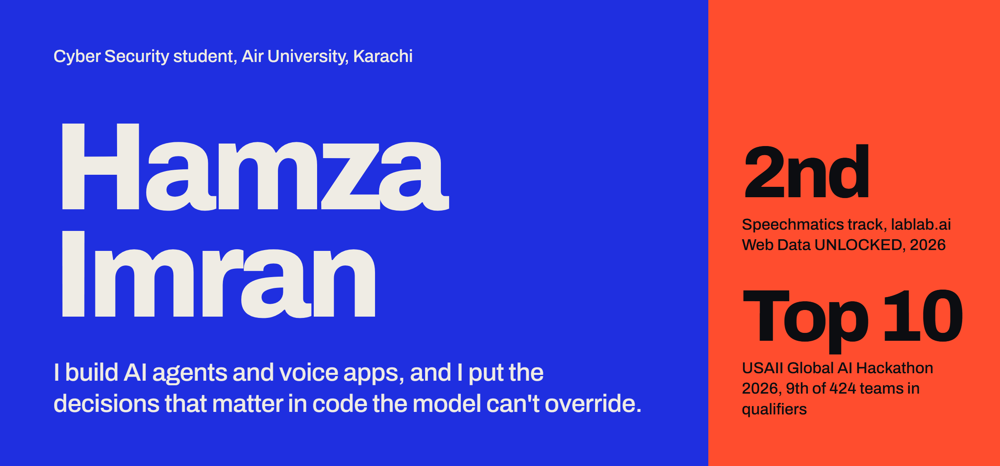
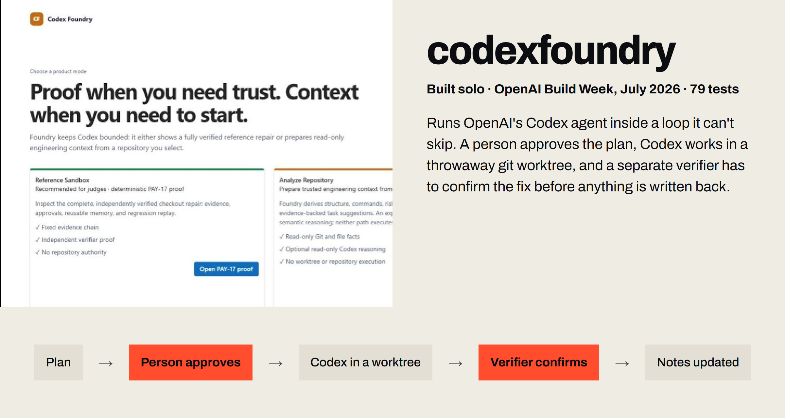
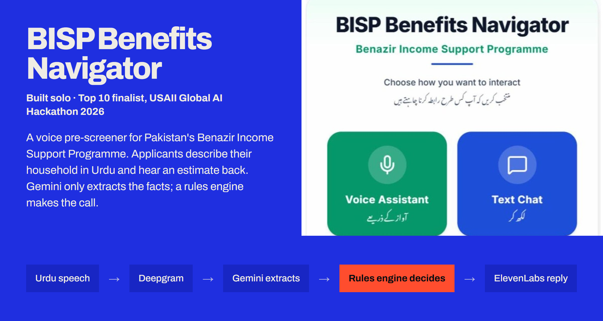
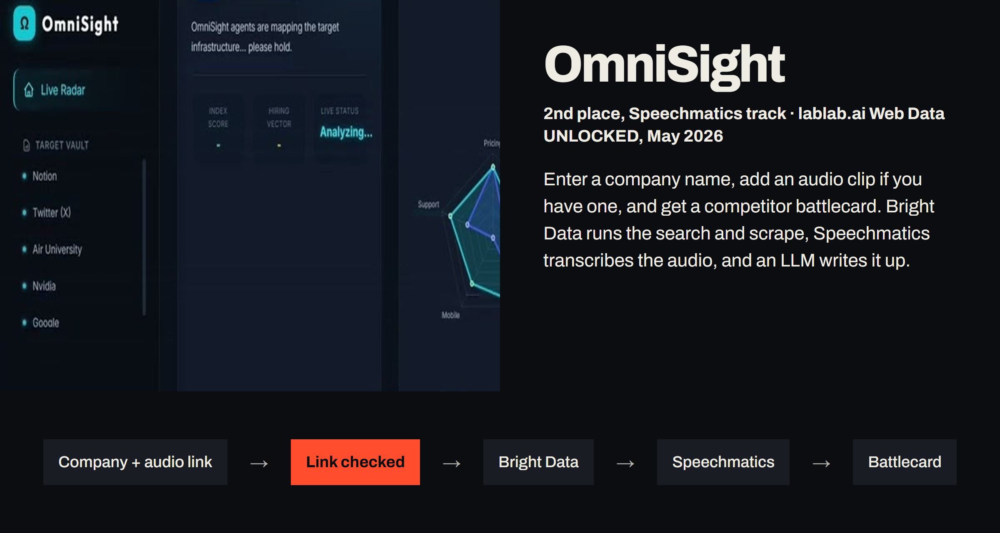
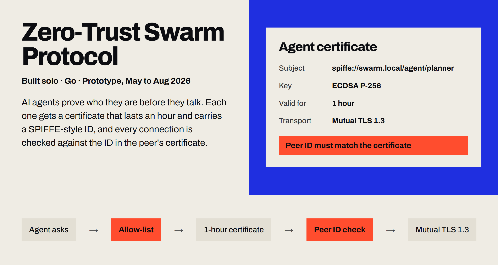
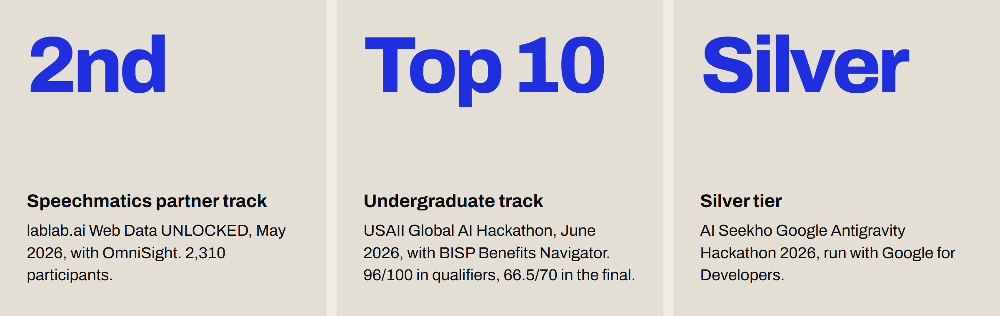
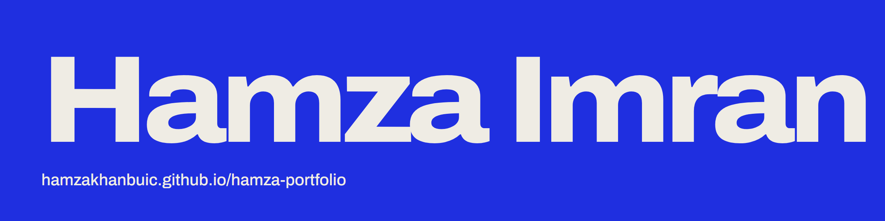

[Portfolio](https://hamzakhanbuic.github.io/hamza-portfolio/) &nbsp;·&nbsp; [LinkedIn](https://www.linkedin.com/in/hamza-imran-17569b383/) &nbsp;·&nbsp; [Email](mailto:hamza135252@gmail.com)

I study cyber security at Air University in Karachi. Most of what I know about building software comes from hackathons and two internships. When a model's output decides something in one of my projects, a check in code has the final say: a rules engine, a person's approval or a certificate the model can't fake.

### Selected work

### More projects

| Project | What it is | Where it came from |
| :-- | :-- | :-- |
| [VeriVoice](https://github.com/HamzaKhanBUIC/Veri-Voice-Unesco-Hackathon) | Fact-checks health and climate rumours sent as voice notes and answers aloud in four languages, as a web app and a Discord bot. 195 tests. | UNESCO Youth Hackathon 2026. I led a team of six. |
| [LifecycleZero](https://github.com/HamzaKhanBUIC/LifecycleZero-Database-Level-Local-AI-Governance-Threat-Isolation) | Console that flags risky local AI processes from signed endpoint telemetry and isolates a host in one DynamoDB transaction. [Live](https://lifecycle-zero.vercel.app) | H0: Hack the Zero Stack (Vercel v0 and AWS Databases) |
| [OmniFlow AI](https://github.com/HamzaKhanBUIC/omniflow-ai) | Venue-operations agent that pulls context through MCP from MongoDB, Elasticsearch and GitLab and asks Gemini for a reroute plan. | Google Cloud Rapid Agent Hackathon |
| [FlyRank capstone](https://github.com/HamzaKhanBUIC/flyrank-ml-internship) | Ranks 30,000 URLs by content decay. Random Forest: 0.70 Precision@50 against 0.40 for the hand-written rule on unseen clients. [Paper](https://hamzakhanbuic.github.io/flyrank-ml-internship/) | ML internship at FlyRank AI |
| [Aegis-QA](https://github.com/HamzaKhanBUIC/Aegis-QA) | Drafts a PyTest suite and a security review for pasted Python code with IBM Granite on watsonx.ai. | IBM Bob Hackathon, May 2026 |
| [The Last Signal](https://github.com/HamzaKhanBUIC/Last-Signal) | Browser survival-horror game with an enemy that hunts you by sight and sound using A* pathfinding. [Play](https://hamzakhanbuic.github.io/Last-Signal/) | Personal project |
| [Local-first LLM agent](https://github.com/HamzaKhanBUIC/amd-developer-hackathon-track1) | Batch agent that runs a 4-bit Qwen 2.5 3B on 2 CPUs and 4 GB of RAM, and calls a hosted model only when an answer fails its check. | AMD Developer Hackathon 2026, team entry |
| [Asal ya Nakli](https://github.com/HamzaKhanBUIC/asal-ya-nakli) | Checks medicine names against sample DRAP and WHO lists in the browser. [Live](https://asal-ya-nakli.web.app/) | GDG Live Pakistan, Chai & Code. Built in 120 minutes. |

### Awards

### Experience

**Community Manager Intern, lablab.ai** (Aug 2026 to now). I moderate the Discord during hackathons, help teams while they build and write the weekly AI recap and the success-stories series.

**ML Engineering Intern, FlyRank AI** (Jun to Sep 2026). I found that a random train/test split let the model memorize clients, so I split by client instead. The ranked refresh queue shipped with a reason code for every page.

**BS Cyber Security, Air University, Karachi** (2026 to 2029). Blue Team member at the AU Cybersecurity Society.

### Open source

- BerriAI/litellm [#47733](https://github.com/BerriAI/litellm/pull/47733): token counting for tool-call blocks in the middle of a conversation (in review)
- BerriAI/litellm [#47858](https://github.com/BerriAI/litellm/pull/47858): enforce access groups in authorization checks (in review)
- elizaOS/eliza: 7 bug fixes with regression tests for Discord reactions, attachments and reply ordering. Reviewers approved them, then upstream shipped its own fixes.

### Tools I use

Python, TypeScript, Go and SQL. LangGraph, the Model Context Protocol, the Gemini API and local models through llama.cpp. Next.js, React, Node.js, FastAPI, DynamoDB and MongoDB. Docker, Google Cloud Run, AWS (SQS, ECS), Vercel and GitHub Actions. For security work: mutual TLS with SPIFFE-style identity, HMAC request signing, the OWASP Top 10 and Semgrep.

