<div align="center">

<!-- Cyberpunk Header Banner -->


<p align="center">
  <b>Cyber Security student @ Air University, Karachi · AI agents, security tools, full-stack prototypes</b>
</p>

<!-- Social & Connection Funnel -->
<p align="center">
  <a href="https://www.linkedin.com/in/hamza-imran-17569b383/"></a>
  <a href="mailto:hamza135252@gmail.com"></a>
  <a href="https://github.com/HamzaKhanBUIC?tab=followers"></a>
</p>

```text
                                          .=**##**+#%@@%+.                                          
                                       .-*##*****#**+==++*:.                                        
                                     .=%%#%%%#++##*++=++=*#:                                        
                                     .#@@%####*##***+==+==+.                                        
                                     ..:++=====+#%%#**++++-.                                        
                                       .*+#%#*+-:-++*++=++-.                                        
                                        :-=++=-:::---++=*+.                                         
                                        :-=+-==-::::-:-++-                                          
                                        .++=====-::---:=-.                                          
                                        .=*++====----::-.                                           
                                         -=+++++++++=::::.                                          
                                         .-++-+#*====::::::.                                        
                                             .=*++=-:::-===-                                        
                                          .---+=::::-====+*+=:.                                     
                                        .:####+=**-:=*#**##**++*+-..                                
                                     .-#%%%%#=+++--*#####*********++=-.                             
                                     :%%%%%%=*+#--*###############*++++=.                           
                                     #%%%%%#*#=+=#%%%%%###%%%%%#%#*+=+++=                           
                                    .%%%%%%++++#%%%%%%%%%%%%%%%%%#*+**##+.                          
                                    .%%%%%#=+**%%%%%%%%%%%%%%%@@@%*+=++*#-                          
                                    .%%%%%#+***%%%@%%%%@@%%%%@@%%%%%*====:                          
                                    :@%%@@*+==%%%@@@@@@@@@%@%@@%##*##*++#:                          
                                    =@%%@@%++#%%@@%@@%%%%%%%%@@@%**##**+=.                          
                                    +@%@%@@#*%%@@%%%%%%@%%@@@@@@@%*++*##+-                          
                                    -@%%@@@@%@@@@%%%%%%@@%@@@@@@#%%%++++*+.                         
                                    -@@@@@@@@@@@@@@@@@@@@@@@@@@@#*%@#+++++.                         
                                    -@@@@@@@@@@@@@@@@@@@@@@@@@@@%**%@#++*+.                         
                                    =@@@@@@@@@@@@@@@@@@@@@@@@@@@%*+*#%%++=                          
                                    -@@@@@@@@@@@@@@@@@@@@@@@@@@@@#*++*%#+-                          
                                    :@@@%*%@@@@@@@%%%%%%%@@@@@@@@%##*++**=                          
                                   .#@@@@@@@@@@@%%%%%%%@@@@@@@@@@@@%*+***+                          
                                   :@@@@@@@@@@@@%%%%@@@@@@@@@@@@**%@@*++*+                          
                                   -@@@@@@@@@@@@@@%%@%%%%@@@@@@@@#==+*#+=-                          
                                   -@@@@@@@@@@@@@@@%%%%%%@@@@@@@@@#+**##*-                          
                                  .#@@@%%%@@@@@@@@@@@@@%%@@@@@@@@@%*===+=.                          
                                  *@@@%%#%@@@@@@%%%%%%%%@@@@@@@%%##**++=.                           
                                  *@@@@%%#%%@@@@@@@%%%%%%%@@@@@@%%*****-                            
                                 .%@@@@@%%##%%@@@@@@@@@@%%@@@@@@@%**##+.                            
                                 =@@@@@@@%%####%@@@%%%%%%@@@@@@@@%*+*#=.                            
                                .%@@@@@@@@@%#####%%%%%%%@@@@%%@@@%*##*.                             
                               .*@@@@@@@@@@@%#**####%%%%%%%@%@@@@@*++-                              
                              .%@@@@@@@@@@@@@@@%%#*******%@@%##%%@%*+-                              
                              :@@@@@@@@@@@@@@@@@@@@%%#**%%%*##%@%#+==.                              
                              .*@@@@@@@@@@@@@@@@@@@@@@**@#*###%%#**@:                               
                               :@@@@@@@@@@@@@@@@@@@@@@@%@%#%%@@@@#@@:                               
                               :%@@@@@@@@@@@@@@@@@@@@@@@@@#*%@@@##@@-                               
                               =@@@@@@@@@@@@@@@@@@@@@@@@@@@@#@@#*@@@=                               
```

</div>

---

## About

I study Cyber Security at Air University, Karachi (2026–2029). I build AI agents, security tools and full-stack prototypes, mostly at hackathons, and I write down what each one does and does not do yet.

- **Machine Learning Engineering Intern**, FlyRank (Jun–Sep 2026, remote)
- **Community Manager Intern**, lablab.ai (since Aug 2026, remote)

## Awards

| Result | Event | Project |
| :--- | :--- | :--- |
| 🥈 2nd place, Speechmatics track | lablab.ai Web Data UNLOCKED (2,310 participants) | [OmniSight](https://github.com/HamzaKhanBUIC/OmniSight-Autonomous-Corporate-Strategy-Disruption-Radar) |
| Top 10 finalist (solo), #9 of 424 teams in qualifiers | USAII Global AI Hackathon 2026 | [BISP Benefits Navigator](https://github.com/HamzaKhanBUIC/BISP-Benefits-Navigator) |
| Silver tier | AI Seekho Google Antigravity Hackathon 2026 | |

---

## Projects

### AI agents

| Project | What it does | Stack |
| :--- | :--- | :--- |
| **[Codex Foundry](https://github.com/HamzaKhanBUIC/codexfoundry)** | Local developer tool that puts AI coding behind human plan approval, an isolated git worktree and an independent verifier. Solo build, OpenAI Build Week. [Demo video](https://youtu.be/5rJSPOZIT-Y) | `TypeScript`, `React` |
| **[OmniSight](https://github.com/HamzaKhanBUIC/OmniSight-Autonomous-Corporate-Strategy-Disruption-Radar)** | Competitor-research dashboard combining Bright Data search, Speechmatics transcripts and an LLM into one battlecard. | `Python`, `Bright Data`, `Speechmatics` |
| **[Aegis-AI](https://github.com/HamzaKhanBUIC/Aegis-AI-The-Omni_Crisis-Intelligence-Swarm)** | LangGraph multi-agent backend that triages urban-crisis reports and picks a dispatch, with Flutter clients on Firebase. | `Python`, `LangGraph`, `FastAPI`, `Flutter` |
| **[BISP Benefits Navigator](https://github.com/HamzaKhanBUIC/BISP-Benefits-Navigator)** | Voice-first pre-screener for Pakistan's BISP programme with Urdu speech input and a mock eligibility estimate. | `Next.js`, `Gemini`, `Deepgram`, `ElevenLabs` |
| **[VeriVoice](https://github.com/HamzaKhanBUIC/Veri-Voice-Unesco-Hackathon)** | Voice-first fact-checking assistant (speech → retrieval → LLM → cited answer → speech) with a Discord bot and 195 automated tests. Team project, UNESCO hackathon. | `Node.js`, `React`, `Groq`, `ElevenLabs` |

### Security

| Project | What it does | Stack |
| :--- | :--- | :--- |
| **[Zero-Trust Swarm Protocol](https://github.com/HamzaKhanBUIC/Zero-Trust-Swarm-Protocol)** | Mutual-TLS 1.3 messaging between AI agents with short-lived certificates and SPIFFE-style IDs bound to each peer. | `Go`, `mTLS`, `SPIFFE` |
| **[LifecycleZero](https://github.com/HamzaKhanBUIC/LifecycleZero-Database-Level-Local-AI-Governance-Threat-Isolation)** | Console that ingests signed endpoint telemetry, flags risky local-AI processes and isolates hosts in one atomic DynamoDB transaction. [Live app](https://lifecycle-zero.vercel.app) | `Next.js`, `DynamoDB`, `AWS` |
| **[aegis-amnesia](https://github.com/HamzaKhanBUIC/aegis-amnesia)** | In-memory vault: one AES-256-GCM key per secret, zeroed when the TTL expires; token-protected local daemon. | `TypeScript`, `Node.js` |

### Machine learning and other builds

| Project | What it does | Stack |
| :--- | :--- | :--- |
| **[FlyRank ML internship](https://github.com/HamzaKhanBUIC/flyrank-ml-internship)** | Content-decay ranking on 30,000 URLs from 32 clients: Random Forest Precision@50 0.70 vs a 0.40 baseline on held-out clients. [Paper](https://hamzakhanbuic.github.io/flyrank-ml-internship/) | `Python`, `scikit-learn` |
| **[Last-Signal](https://github.com/HamzaKhanBUIC/Last-Signal)** | Browser survival-horror game with an A* pathfinding enemy that hunts by sight and sound. [Play](https://hamzakhanbuic.github.io/Last-Signal/) | `JavaScript`, `Canvas`, `Web Audio` |
| **[doc-intel-platform](https://github.com/HamzaKhanBUIC/doc-intel-platform)** | Rule-based invoice checker: re-checks the arithmetic and fuzzy-matches vendors (no OCR yet). | `Node.js` |

Every README lists the project's status and its known limitations.

---

## Tech stack

<div align="center">


</div>

---

## GitHub Activity & Telemetry

<div align="center">

  <table border="0" cellpadding="0" cellspacing="0" style="border: none;">
    <tr style="border: none;">
      <td style="border: none; padding: 5px;">
        
      </td>
      <td style="border: none; padding: 5px;">
        
      </td>
    </tr>
  </table>
  
  <br />
  
  <!-- Contribution Snake Animation -->
  
  
</div>
